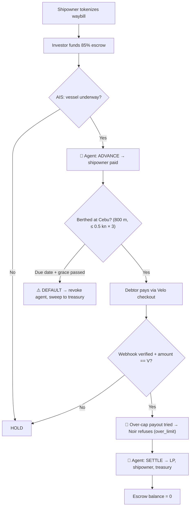
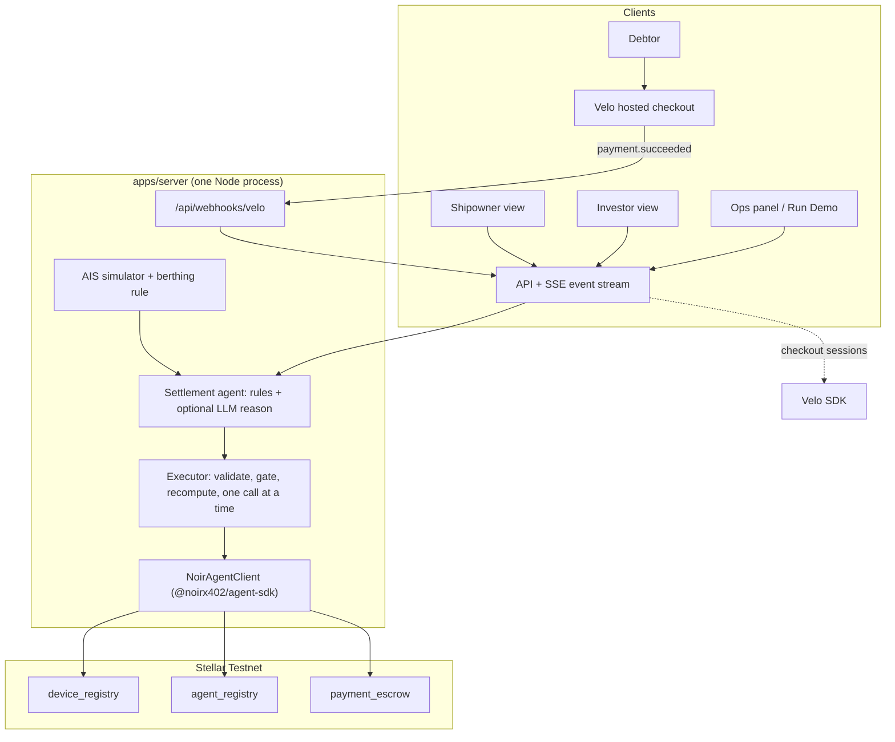

<p align="center">
  
</p>

<h1 align="center">Sailo</h1>

<p align="center">
  <b>Built for the Velo × Noir Agentic Payment Hackathon ⚓</b><br>
  Freight advances for island shipping lines, guarded by an AI that can't overspend.<br>
  Ships get 85% of a freight invoice the day they sail. The agent decides when to pay; the chain decides how much it's allowed to.
</p>

<p align="center">
  <a href="https://stellar.org/"></a>
  <a href="https://github.com/noirx402/noir"></a>
  <a href="https://velo-build.dev"></a>
  <a href="https://www.typescriptlang.org/"></a>
  <a href="#"></a>
</p>

<p align="center">
  
  
  
  
  
</p>

<p align="center">
  <a href="https://sailo.pdyntech.com"></a>
  <a href="https://drive.google.com/file/d/1Cr3ncFfuCpBHOgGlcBWTrQGCC-COpCrC/view?usp=share_link"></a>
  <a href="https://drive.google.com/file/d/1oCUmO3Og3WVbIg9tBZ6OpIl-SqDwVyF2/view?usp=sharing"></a>
</p>

**Live website:** https://sailo.pdyntech.com<br>
**Demo video (2 min):** https://drive.google.com/file/d/1Cr3ncFfuCpBHOgGlcBWTrQGCC-COpCrC/view?usp=share_link<br>
**Pitch deck:** https://drive.google.com/file/d/1oCUmO3Og3WVbIg9tBZ6OpIl-SqDwVyF2/view?usp=sharing<br>
**Team:** Helena (haenlenaeean), Ethan (perrytot_), Dia Aviles (kirs6103)

<p align="center">
  <a href="#problem">Problem</a> ·
  <a href="#solution">Solution</a> ·
  <a href="#how-the-agentic-payment-works">Agentic Payment</a> ·
  <a href="#architecture">Architecture</a> ·
  <a href="#noir-integration">Noir</a> ·
  <a href="#velo-integration">Velo</a> ·
  <a href="#testnet-proof">Testnet Proof</a> ·
  <a href="#repo-structure">Repo</a> ·
  <a href="#run-it-locally">Run It</a> ·
  <a href="#environment-variables">Env</a> ·
  <a href="#whats-next">What's Next</a> ·
  <a href="#credits">Credits</a>
</p>

---

## Problem

Philippine inter-island shipping lines pay for bunker fuel, port dues and crew **before** they leave port. The cargo owners they carry for pay on **Net-60 to Net-90** terms. Small operators fill that gap with slow bank factoring or expensive informal loans. Lenders hold back because paper waybills can be pledged twice and no one can easily confirm the cargo arrived.

---

## Solution

**Sailo** turns a freight invoice into a bounded on-chain escrow on Stellar.

- **Invoice = device.** The e-Waybill hash is registered on Noir's `device_registry`. Each invoice gets its own escrow balance, and a duplicate registration is rejected on-chain.
- **An investor funds 85%.** The shipowner gets the money the day the vessel sails, around ₱850,000 on a ₱1,000,000 invoice.
- **Delivery is proven.** The agent signs a berthing attestation when the ship sits inside the Cebu port geofence.
- **The cargo owner pays through a normal Velo checkout.** A verified Velo webhook triggers settlement: the agent repays the investor, returns the reserve to the shipowner and takes a 0.5% fee.
- **The agent can't overspend.** Every payout passes through Noir's `agent_registry`, which enforces a per-payment cap, asset and expiry.

The site has two parts: a **live Testnet demo** at `/app` that runs the full loop on real Noir contracts, and a **role portal** where shipowners, investors and cargo owners sign up, tokenize, fund and pay invoices on one shared ledger. Portal invoices also run on Stellar Testnet: each shipowner and investor gets a Testnet wallet, and the same agent and Noir contracts register, fund, advance and settle them (sample invoices for new accounts stay simulated and are labelled).

| Step | From → To | Demo ₱ | XLM |
| :-- | :-- | --: | --: |
| LP funds escrow | LP → escrow | 850,000 | 850 |
| Advance | escrow → shipowner | 850,000 | 850 |
| Debtor pays | debtor → Velo → treasury → escrow | 1,000,000 | 1,000 |
| LP repayment | escrow → LP | 880,000 | 880 |
| Reserve rebate | escrow → shipowner | 115,000 | 115 |
| Protocol fee | escrow → treasury | 5,000 | 5 |
| **Check** | `balanceOf(invoice)` after settlement | **0** | **0** |

Testnet demo amounts at a fixed rate of **1 XLM = ₱1,000**. The investor deploys 85% and earns 3% of face, so the return is 3.53% over 60 days (illustrative, not guaranteed).

---

## How the agentic payment works

The settlement agent decides **when**, **whom** and **how much**. Code checks everything it proposes before any money moves.

1. **The agent proposes a decision:** `ADVANCE`, `SETTLE`, `HOLD` or `DEFAULT`, with a one-line reason and payouts by **role** (`SHIPOWNER`, `LP`, `TREASURY`), never by wallet address. See [`propose`](apps/server/src/agent.ts#L32) and [`decide`](apps/server/src/agent.ts#L103).
2. **An LLM writes the reason** when `LLM_API_KEY` is set. Amounts never come from the model. If the model is slow or down, the rules text is used.
3. **A deterministic executor checks it.** [`validateDecision`](packages/agent/src/executor.ts#L43) checks the shape, then [`execute`](packages/agent/src/executor.ts#L200) checks the preconditions for the current state, recomputes every payout in integer math, maps roles to stored wallets and calls Noir.
4. **Noir enforces the limits.** Each payment is pre-checked with `checkPayment`. Anything over the cap, expired or underfunded is refused before a fee is paid.
5. **It fails closed.** Any mismatch or refusal becomes a `HOLD` that reports what already landed. `execute` never throws.

| Decision | Preconditions (checked in code) | Payouts |
| :-- | :-- | :-- |
| `ADVANCE` | Funded, escrow ≥ advance, vessel underway, `checkPayment.ok` | `SHIPOWNER = 85% of V` |
| `SETTLE` | Paid, webhook verified, amount == V, berthing attestation present, `checkPayment.ok` per payout | `LP = 85% + 3%`, `SHIPOWNER = rebate`, `TREASURY = 0.5%`; sum == V |
| `HOLD` | Any precondition fails or an anomaly is flagged | none |
| `DEFAULT` | Due date + grace passed, no payment | none (ops revokes and sweeps) |



### Voyage stages

| Stage | Trigger | Who acts | On-chain effect |
| :-- | :-- | :-- | :-- |
| **1. Tokenized** | Shipowner submits the waybill | Treasury | `registerDevice` + `registerAgent` (cap 880 XLM) |
| **2. Funded** | Investor commits capital | LP | `fundEscrow` 850 XLM |
| **3. Advanced** | First AIS "underway" tick | 🤖 Agent decides **ADVANCE** | `authorizePayment` 850 → shipowner, then `claim` |
| **4. Berthed** | Inside 800 m Cebu geofence at ≤ 0.5 kn for 3 ticks | 🤖 Agent signs attestation | Off-chain proof of delivery |
| **5. Paid** | Verified Velo `payment.succeeded` webhook | Treasury | `fundEscrow` 1,000 XLM |
| **🛑 Guardrail** | Agent tries a single 1,000 XLM payout | Noir refuses | `checkPayment` → `over_limit`, no tx, no fee |
| **6. Settled** | Both settle gates pass | 🤖 Agent decides **SETTLE** | 3× `authorizePayment` (LP 880, shipowner 115, treasury 5), each payee claims, escrow = 0 |
| **⚠️ Default** | Due date + grace passed, no payment | Ops | `unlinkDevice` (revoke agent + sweep escrow to treasury) |

### Guardrails and compliance

- **Capped on-chain.** Every payment is checked by Noir's `agent_registry`. A single payout above the cap is refused before any fee is paid.
- **Roles, not addresses.** The agent names who gets paid. Code maps roles to stored wallets and recomputes every amount, so the model can never pay an arbitrary wallet or see a secret.
- **Two gates to settle.** A verified Velo webhook for the exact invoice amount, confirmed with Velo's payment status (`paid`, expected asset), plus a signed berthing attestation.
- **Advance only once under way.** The agent's `ADVANCE` gate reads the AIS readings: no payout until the vessel is under way. Berthing is the same rule everywhere: the last 3 readings at the quay at ≤ 0.5 kn.
- **No double payouts.** One payment in flight per agent, and webhooks are de-duplicated by delivery ID before any side effect. A payout interrupted half-way resumes from the escrow balance: it tells exactly which payouts already landed, and any balance it can't explain holds the invoice.
- **No double pledging.** A second `registerDevice` for the same waybill hash is rejected on-chain (spike S3).
- **Fail closed.** Any mismatch becomes a `HOLD`. On default, ops revokes the agent and sweeps the escrow back to treasury.
- **Known limit.** Noir's policy caps each payment and its expiry, not the payee or the running total, so the agent key is kept server-side and code chooses payees by role. Per-invoice agent keys are on the roadmap.
- **Clear about what's simulated.** Real: Noir contracts on Testnet, every escrow, authorize and claim, the per-payment cap and the Velo webhook HMAC check. Simulated: AIS vessel positions, the fixed 1 XLM = ₱1,000 rate, and the debtor payment when no Velo key is set. Velo pays the debtor's payment to the project's receiver address; the treasury then funds the invoice escrow from its own Testnet wallet.
- **Testnet prototype.** Factoring is regulated in the Philippines, and invoice-backed products for investors may count as securities. Shipper, vessel and debtor are fictional. Not financial advice.

### FAQ

**Why does the agent need a cap if code already checks the amounts?**
Defense in depth. If the agent key leaks or the code has a bug, Noir's `agent_registry` still refuses any single payment above 880 XLM, before a fee is paid.

**Can the AI send money to its own wallet?**
No. The model only names roles (`SHIPOWNER`, `LP`, `TREASURY`). Code maps those to stored addresses and recomputes every amount. A mismatch becomes a `HOLD`.

**What if the ship anchors offshore near Cebu?**
It doesn't count. Berthing requires being inside the 800 m geofence **and** at ≤ 0.5 knots for three readings in a row.

**What if the cargo owner never pays?**
After the due date plus grace, ops triggers `DEFAULT`: the agent is revoked and the escrow is swept back to treasury. In this MVP the investor bears the loss, and the UI says so.

**What if Testnet is down during the demo?**
The server can switch to an in-memory version of the contracts. Every screen labels it "simulated".

---

## Architecture



### Tech Stack

| Category | Technology | Purpose |
| :-- | :-- | :-- |
| **Chain** | [Stellar Testnet](https://stellar.org/) + [`@noirx402/agent-sdk`](https://github.com/noirx402/noir) 0.3.0 | Device registry, agent policy, escrow, authorize, claim, revoke and sweep |
| **Payments** | [`@carts1024/velo-sdk`](https://velo-build.dev) 0.1.0-alpha.4 | Debtor checkout sessions and signed webhooks (server only) |
| **Server** | Node 24 + TypeScript (`tsx`) | API, webhook receiver, agent runtime, AIS simulator, SSE stream |
| **Frontend** | HTML / CSS / vanilla JavaScript | Landing page, role portal, voyage chart, decision stream, ops panel |
| **Accounts** | scrypt passwords, HttpOnly session cookies, Nodemailer (SMTP) | Sign-up, email verification, password reset, rate limits |
| **Agent reasons** | Anthropic Messages API (optional) | Writes the one-line reason; amounts always come from code |
| **Tests** | Vitest | Math, decision validator, executor gates, guardrail, recovery |

---

## Noir integration

**SDK:** `@noirx402/agent-sdk` **0.3.0** (pinned). The agent touches the chain **only** through this SDK, on the deployed Testnet contracts from the SDK's built-in `TESTNET` config. No custom deployments.

| Contract | Testnet ID |
| :-- | :-- |
| `device_registry` | `CAC4KOLHDLDYDWBOKXNKRN5KVHO56PLOIFXDLTBUWGVN6GVDEB7FQHU5` |
| `agent_registry` | `CCMZDSPTLX7IIJWCYEUM5DJUHOSOYSTHGK777S2TXZWEMC5ZZGPJ3EBV` |
| `payment_escrow` | `CC7EAW5FNJEDBS7THM5IT6XIOHO4AOYMLXT3KSZ3HWUIKEACTW7E5BFS` |

All calls go through one wrapper, [`NoirAgentClient`](packages/agent/src/client.ts):

| Step | Method | Signer | Code |
| :-- | :-- | :-- | :-- |
| Asset (native XLM SAC) | `Asset.native().contractId(Networks.TESTNET)` | none | [client.ts#L10](packages/agent/src/client.ts#L10) |
| All writes | `sdk.execute(signer, op)` | varies | [client.ts#L77](packages/agent/src/client.ts#L77) |
| Register invoice as device | `registerDevice` | treasury | [client.ts#L83](packages/agent/src/client.ts#L83) |
| Set agent policy (cap, asset, expiry) | `registerAgent` | treasury | [client.ts#L87](packages/agent/src/client.ts#L87) |
| Fund escrow | `fundEscrow` | LP, then treasury | [client.ts#L99](packages/agent/src/client.ts#L99) |
| Pre-check | `checkPayment` | none (read) | [client.ts#L103](packages/agent/src/client.ts#L103) |
| Pay (pre-checked, returns the real refusal reason) | `authorizePayment` | **agent** | [client.ts#L120](packages/agent/src/client.ts#L120) |
| Collect | `claim` | shipowner / LP / treasury | [client.ts#L147](packages/agent/src/client.ts#L147) |
| Escrow balance | `balanceOf` | none (read) | [client.ts#L151](packages/agent/src/client.ts#L151) |
| Default: revoke agent + sweep | `unlinkDevice` | treasury | [client.ts#L160](packages/agent/src/client.ts#L160) |

Related code: the executor's [`execute`](packages/agent/src/executor.ts#L200), the over-limit [`runGuardrail`](packages/agent/src/guardrail.ts#L44), default recovery in [`recovery.ts`](packages/agent/src/recovery.ts), and a per-(device, agent) lock in [`mutex.ts`](packages/agent/src/mutex.ts) so the agent never has two payments in flight.

---

## Velo integration

**SDK:** `@carts1024/velo-sdk` **0.1.0-alpha.4**, server side only.

| Feature | Code |
| :-- | :-- |
| Debtor checkout session (`velo.checkout.sessions.create`, asset `native`, idempotency key per invoice) | [`createCheckout`, velo.ts#L44](apps/server/src/velo.ts#L44) |
| Signed webhook verification (`Velo.webhooks.verify`, raw body, 300 s tolerance) | [`verifyWebhook`, velo.ts#L122](apps/server/src/velo.ts#L122) |
| Payment status (`velo.paymentIntents.retrieve`): before any money moves, the intent must be `paid` in the expected asset; Velo's amount wins over the webhook body | [`retrievePaymentStatus`, velo.ts#L83](apps/server/src/velo.ts#L83), checked in [webhooks.ts#L44](apps/server/src/webhooks.ts#L44) |
| Webhook route `POST /api/webhooks/velo` | [app.ts#L144](apps/server/src/app.ts#L144) |
| De-dupe by `x-velo-delivery`, match amount to the invoice, then treasury funds escrow | [`applyPayment`, demo.ts#L597](apps/server/src/demo.ts#L597) |

Without `VELO_API_KEY`, checkout is simulated and **labelled as simulated** in the UI. Without `VELO_WEBHOOK_SECRET`, only self-signed simulated deliveries pass verification.

---

## Testnet proof

Every transaction below was made on Stellar Testnet through the Noir SDK by the same agent code the demo uses. The settle run was recorded 7 Nov 2026; the lifecycle and default runs on 6 Nov 2026 by [`scripts/lifecycle.ts`](scripts/lifecycle.ts) and [`scripts/default-demo.ts`](scripts/default-demo.ts). Full details are in [`docs/testnet-proof.md`](docs/testnet-proof.md).

<p align="center">
  <a href="https://stellar.expert/explorer/testnet/tx/2c0cb3dc217caa3378e24958f6cae9941ca68c2bf845453aa193d0b2b09afdec"></a>
  <br><sub>End-to-end demo run on the live site (7 Nov 2026): the investor's 880 XLM settlement claim on the Noir payment escrow, signed by the investor and confirmed on Stellar Testnet (ledger 5604688, status Successful): <a href="https://stellar.expert/explorer/testnet/tx/2c0cb3dc217caa3378e24958f6cae9941ca68c2bf845453aa193d0b2b09afdec">2c0cb3dc…afdec</a>.</sub>
</p>

**Full loop, end to end (register → fund → advance → Velo payment → settle → claims)**

Recorded 7 Nov 2026 with **▶ Run Demo** (`POST /api/run-demo`) in Testnet mode, using the same code as the live site. Agent wallet: [`GAP6Z…P5YV`](https://stellar.expert/explorer/testnet/account/GAP6ZDGBGPJMOYRJONXAEH5J334U5V3TR74LXRSDCWEY6NZY5ZLIP5YV).

| Step | Transaction |
| :-- | :-- |
| Invoice registered (`device_registry`) | [056d4274…aca2](https://stellar.expert/explorer/testnet/tx/056d4274e62c7f8bd9063c1506d7da5aa23509d0ca327150adbb10fd16a5aca2) |
| Agent policy, 880 XLM cap (`agent_registry`) | [d0dcb52b…5728](https://stellar.expert/explorer/testnet/tx/d0dcb52beb3df2bbfef044f376ff4a00bd3828fc533f4392f9526072a4255728) |
| Investor funds 850 XLM escrow | [e3bac447…3bdc](https://stellar.expert/explorer/testnet/tx/e3bac44782f0eb3845b57cef39ed9db1a0f056d1dc3cfad88dca012ba64f3bdc) |
| **🤖 Agent ADVANCE: authorizes 850 XLM → shipowner** | [8b8384d7…995c](https://stellar.expert/explorer/testnet/tx/8b8384d7a8e2212777a400b09fb55c70e1b176d7d67eb8fd4f9fc720cafd995c) |
| Shipowner claims the advance | [84962bc6…901c](https://stellar.expert/explorer/testnet/tx/84962bc6cf735326adfc28e7eb11e25d87bb0ad78580b12b9a5599cfda7c901c) |
| Treasury funds 1,000 XLM after the verified Velo webhook | [99d907da…a4f2](https://stellar.expert/explorer/testnet/tx/99d907dae85d80736f306b467d7b882cb5f527db78a47c3178db93a11214a4f2) |
| **🤖 Agent SETTLE: authorizes 880 XLM → investor** | [d2d0c38b…388f](https://stellar.expert/explorer/testnet/tx/d2d0c38b2f482af4cb25bc3b4df14dec4a932cfb198ff4a7cfec268d4869388f) |
| **🤖 Agent SETTLE: authorizes 115 XLM → shipowner** | [08d9f63b…91c5](https://stellar.expert/explorer/testnet/tx/08d9f63ba0430198e7281a9ada1960fb134f9aa630e64187208e8a641a4891c5) |
| **🤖 Agent SETTLE: authorizes 5 XLM → treasury** | [83177fb2…b773](https://stellar.expert/explorer/testnet/tx/83177fb2a9b0fc91eee8ff20f07e33a479e29c7b2d64ee944f22d6893ac4b773) |
| Investor claims | [2ecab943…fe00](https://stellar.expert/explorer/testnet/tx/2ecab94382baec3341199fa999122e7b465210fcf615493fbc4a9e76dc69fe00) |
| Shipowner claims | [6ace8dae…5de1](https://stellar.expert/explorer/testnet/tx/6ace8dae1716ff357b9a38a40f86b9d20a7a72fb3dab80917789605115d35de1) |
| Treasury claims | [de6a987b…f3a6](https://stellar.expert/explorer/testnet/tx/de6a987b74c94853d2ce393d2a0922717d88f1d3735daa5dfb67101b2bccf3a6) |

After the claims, `balanceOf(invoice)` is `0`. In the same run, the agent's 1,000 XLM over-cap payout was refused by `checkPayment` with `over_limit` (contract error `AgentNotAuthorized #3`), with no transaction sent and no fee paid.

**Earlier lifecycle run (register → fund → advance → claim)**

| Step | Transaction |
| :-- | :-- |
| Invoice registered (`device_registry`) | [9ba6b79c…7c5f](https://stellar.expert/explorer/testnet/tx/9ba6b79cf1b1732d2583f583f2cb7c2674fddf1badb8bc2f6dff2f044ec97c5f) |
| Agent policy, 880 XLM cap (`agent_registry`) | [9bde0260…4faa](https://stellar.expert/explorer/testnet/tx/9bde02602a5a3f4b55f967339d1953133d366b403452647f7d1bb801c5614faa) |
| Investor funds 850 XLM escrow | [3d546679…9dd7](https://stellar.expert/explorer/testnet/tx/3d546679502258b0e8e8d63ff023cca458aeb3a6270142527b233a653e249dd7) |
| **Agent authorizes 850 XLM advance** | [d8899a5b…2385](https://stellar.expert/explorer/testnet/tx/d8899a5bff111ea3a82daa4b421100f88a8589d10c506197aadf5700e2b82385) |
| Shipowner claims the advance | [0c540e37…392c](https://stellar.expert/explorer/testnet/tx/0c540e3762d646d2eb84bd1bdfd377f4229c0be974cce5c7d66c8b77989a392c) |

After the claim, the escrow balance is `0` and the shipowner is up +849.9989932 XLM (850 minus the claim fee).

**Default recovery (revoke agent + sweep escrow to treasury)**

| Step | Transaction |
| :-- | :-- |
| Invoice registered | [25d85019…7d](https://stellar.expert/explorer/testnet/tx/25d85019f2847a97d1e3fd15682d1635bef4297cda744deeaa6ec401f4310f7d) |
| Agent policy, 880 XLM cap | [88482636…ff](https://stellar.expert/explorer/testnet/tx/8848263641f3988bda6251a3eb0b71df99eb9f5e1820c758511015d1fc2a1cff) |
| Investor funds 850 XLM | [ec5381b8…35](https://stellar.expert/explorer/testnet/tx/ec5381b899a2390fb0323b43f836c424e734b01e4284b0c26fa75c868cf88e35) |
| Recovery tx 1 | [eb14b8b4…6d](https://stellar.expert/explorer/testnet/tx/eb14b8b43ad44912e29afe9a29de69d23845183a52f389737bef4f6982578d6d) |
| Recovery tx 2 | [bef895a6…0b](https://stellar.expert/explorer/testnet/tx/bef895a6e84895201b518b31ee4469facc89cc270f44c8fa7feffd036daa5f0b) |
| Recovery tx 3 | [b18ca2e2…a8](https://stellar.expert/explorer/testnet/tx/b18ca2e28aeaace389cea32ab9204e84fbe5f4975d9db20cc8871b783a8868a8) |

Escrow went from 850 to 0, and treasury was up +849.9978111 XLM. After revoke, `checkPayment` returns `no_agent` and the wrapper refuses to send.

**Guardrail:** an over-cap payout is refused by `checkPayment` with `over_limit` before any transaction or fee (spike S8 in [`docs/spikes.md`](docs/spikes.md)).

---

## Repo structure

```text
noirxvelo/
├── apps/
│   ├── server/                 # One Node process: API, Velo webhook, agent runtime, static frontend
│   │   └── src/
│   │       ├── index.ts        # Long-running server entry (npm start)
│   │       ├── app.ts          # HTTP routes, SSE stream, /api/webhooks/velo
│   │       ├── vercel.ts       # Vercel function entry (same handler)
│   │       ├── demo.ts         # Invoice state machine and Run Demo loop
│   │       ├── agent.ts        # Decision policy (roles only) + optional LLM reason
│   │       ├── telemetry.ts    # AIS simulator and Cebu berthing rule
│   │       ├── velo.ts         # Velo checkout, payment status, webhook verification
│   │       ├── webhooks.ts     # POST /api/webhooks/velo: verify, confirm status, de-dupe, route
│   │       ├── simchain.ts     # In-memory contracts for labelled simulation mode
│   │       ├── site.ts         # Website API: auth, portal, enquiry/newsletter routes
│   │       ├── accounts.ts     # Accounts, sessions, verification, reset, rate limits
│   │       ├── portal.ts       # Shared role portal ledger (shipowner, investor, cargo owner)
│   │       ├── portal-chain.ts # Portal invoices on Stellar Testnet: jobs, agent payouts, exact resume
│   │       ├── wallets.ts      # Custodial Testnet wallets (AES-256-GCM), Friendbot top-ups, per-account lock
│   │       ├── kv.ts           # Shared Redis store and locks (Vercel)
│   │       ├── db.ts           # JSON store (data/sailo.json, git-ignored)
│   │       └── mailer.ts       # SMTP email (logs links in development)
│   └── web/                    # Static frontend (no build step)
│       ├── index.html          # Sailo landing page + portal (site.js, portal.js)
│       ├── app/index.html      # Live Testnet demo (/app)
│       └── assets/             # hero.jpg, voyage.jpg
├── packages/
│   ├── agent/                  # NoirAgentClient, executor, guardrail, recovery, mutex
│   └── shared/                 # Types, canonical waybill hash, payout math, seed data, store
├── scripts/
│   ├── provision.ts            # Creates and funds Testnet wallets into .env.local
│   ├── lifecycle.ts            # Full Noir lifecycle smoke test
│   ├── default-demo.ts         # Default + recovery on Testnet
│   └── spikes/                 # S2, S3, S8 live checks
├── docs/                       # spikes.md, testnet-proof.md, worklog.md
├── PRD.md                      # Product requirements
├── .env.example
├── .nvmrc                      # Node 24.22.1
└── package.json                # npm workspaces: apps/*, packages/*
```

---

## Run it locally

**You need:** Node **24.22.1** (see `.nvmrc`; older Node silently installs the retired agent-sdk 0.2.0) and internet access to Stellar Testnet. No wallet extension is needed: `provision` creates and funds Testnet wallets with Friendbot.

```bash
git clone https://github.com/pdyntech/sailo.git
cd sailo
nvm use                   # Node 24.22.1
npm install               # one install at the repo root (workspaces)
npm run provision         # once: creates + funds Testnet wallets into .env.local
npm start                 # http://localhost:3000
```

Optional: add `VELO_API_KEY`, `VELO_WEBHOOK_SECRET` and `LLM_API_KEY` to `.env.local` (see `.env.example`). Without them, checkout and webhooks run in a labelled simulated mode.

Open **http://localhost:3000** for the landing page and portal ("Get started" creates an account; in development, email links show up in the UI and server log). For the Testnet loop, open **http://localhost:3000/app** and press **▶ Run Demo** in the Ops panel. The whole loop runs on Stellar Testnet in about 90 seconds. Every step is also a manual button in the Shipowner, Investor and Debtor views.

Other commands:

```bash
npm test                  # unit tests (Vitest)
npm run lifecycle         # full Noir lifecycle on Testnet, prints Stellar Expert links
npm run default-demo      # default + recovery on Testnet
```

**Deploy:** Vercel (`vercel.json` is included) with a Redis store: add **Upstash** from the Vercel Marketplace (Storage tab), which sets `KV_REST_API_URL` and `KV_REST_API_TOKEN`. Accounts, portal invoices and the demo run are then shared by every instance and survive restarts. Render or Railway also work: start command `npm start`, Node 24, and point `DATA_DIR` at a persistent disk (or add the same Redis variables). Then set the Velo webhook URL to `https://<your-host>/api/webhooks/velo`. Health check: `GET /api/health`. See [`apps/server/README.md`](apps/server/README.md).

---

## Environment variables

| Name | What it is | Where to get it |
| :-- | :-- | :-- |
| `TREASURY_*`, `SHIPOWNER_*`, `LP_*`, `DEBTOR_*`, `AGENT_*`, `RELAYER_*` (`_PUBLIC`, `_SECRET`) | Testnet demo wallets | `npm run provision` |
| `VELO_API_KEY` | Velo Testnet API key (real checkout sessions) | [velo-build.dev](https://velo-build.dev) dashboard |
| `VELO_WEBHOOK_SECRET` | Verifies Velo webhooks | Velo dashboard |
| `VELO_CHECKOUT_ASSET` | Checkout asset, default `native` | Optional |
| `APP_URL` | Public site URL for checkout success and cancel links | Hosting provider |
| `LLM_API_KEY`, `LLM_MODEL` | Optional model that writes the decision reason | LLM provider |
| `DATA_DIR` | Folder for accounts, sessions and portal invoices (`sailo.json`) | A persistent disk on the host |
| `SMTP_URL`, `MAIL_FROM` | Outgoing email for verification and password reset | Any SMTP provider (e.g. Resend, Gmail app password) |
| `NODE_ENV` | `production` hides development email links in the UI | Hosting provider |
| `TRUST_PROXY` | `1` trusts `X-Forwarded-For` (on by default in production) | Optional |
| `PORTAL_VOYAGE_MS` | Portal voyage length, default `60000` (the advance's Testnet transactions run during the voyage) | Optional |
| `KV_REST_API_URL`, `KV_REST_API_TOKEN` (or `UPSTASH_REDIS_REST_*`, or `REDIS_URL`) | Shared Redis store for accounts, portal invoices and the demo run. Required on Vercel | Upstash via the Vercel Marketplace |
| `WALLET_ENCRYPTION_KEY` | Encrypts the portal's custodial Testnet wallet keys. Defaults to a key derived from `TREASURY_SECRET`: keep that secret unchanged, or existing portal wallets can't be unlocked | Optional |
| `PORTAL_ONCHAIN` | `0` runs new portal invoices in memory (simulated) instead of on Stellar Testnet | Optional |
| `OPS_TOKEN` | Lets the operator switch the live site between Testnet and simulation (open `/app?ops=<token>` once). Unset on a deployed server: switching is off | Optional, recommended on deploy |
| `PORT` | Server port, default `3000` | Optional |
| `DEMO_TICK_MS` | AIS tick interval, default `1800` | Optional |
| `SIM_LATENCY_MS` | Fake network delay in simulation mode, default `450` | Optional |
| `NOIRXVELO_DATA_FILE` | File for the demo invoice store; empty keeps it in memory | Optional |
| `LIVE` | `1` runs the live Testnet tests in `npm test` | Optional, tests only |
| `SIMULATE_CHAIN` | `1` runs the contracts in memory, labelled "simulated". Turns on automatically when wallet keys are missing | Optional |

---

## Screenshots

**Landing page:** hero, invoice card and headline numbers.


**Live Testnet demo, settled:** see the screenshot in [Testnet proof](#testnet-proof).

---

## What's next

- **Per-invoice agent keys** (or a payee allow-list in the policy), so one leaked key can't touch other invoices.
- **Live AIS** feeds plus terminal discharge data, so delivery doesn't rest on AIS alone (it can be spoofed).
- **PHP stablecoin** settlement and an off-ramp, in place of testnet XLM at a demo rate.
- **Investor pool contract** so many LPs can fund many invoices.
- **SEC pathway:** financing company licence or regulatory sandbox.

---

## Credits

| Member | GitHub | Discord | Lane |
| :-- | :-- | :-- | :-- |
| Helena | [@helenaherrero515](https://github.com/helenaherrero515) | `haenlenaeean` | Fullstack Developer and DevOps |
| Ethan | [@thanreiz](https://github.com/thanreiz) | `perrytot_` | Blockchain Developer |
| Dia Aviles | [@krstndiane](https://github.com/krstndiane) | `kirs6103` | Project manager & Frontend Developer |

Built on [Noir](https://github.com/noirx402/noir) agent contracts, [Velo](https://velo-build.dev) checkout and the [Stellar](https://stellar.org/) Testnet.

**Libraries**

| Library | Used for |
| :-- | :-- |
| [`@noirx402/agent-sdk`](https://github.com/noirx402/noir) 0.3.0 | All Noir contract calls (register, policy, escrow, check, authorize, claim, unlink) |
| [`@carts1024/velo-sdk`](https://github.com/Velo-Ecosystem-Collection/Velo) 0.1.0-alpha.4 | Checkout sessions and signed webhook verification |
| [`@stellar/stellar-sdk`](https://github.com/stellar/js-stellar-sdk) 16.4.1 | Keypairs, native XLM asset contract, Testnet config |
| [Nodemailer](https://nodemailer.com/) | Verification and password-reset email |
| [`@vercel/functions`](https://vercel.com/docs/functions) | Vercel deployment of the API |
| [tsx](https://github.com/privatenumber/tsx), [esbuild](https://esbuild.github.io/), [TypeScript](https://www.typescriptlang.org/), [Vitest](https://vitest.dev/) | Running, bundling, typing and testing |
| [Anthropic Messages API](https://docs.anthropic.com/) (optional) | Writes the one-line reason for each agent decision |
| [Mermaid](https://mermaid.js.org/) | Diagrams in this README |

**Ideas and references:** the Velo × Noir Builder Handbook, the Noir [SDK examples](https://github.com/noirx402/noir) (`check-and-pay.ts`, webhook relay) and the Velo [Express / Next.js examples](https://github.com/Velo-Ecosystem-Collection/Velo). Invoice factoring and AIS-based proof of delivery are standard trade-finance ideas, applied here to inter-island shipping.

---

© 2026 Sailo. Testnet prototype for the Velo × Noir Agentic Payment Hackathon. Fictional shipper, vessel and debtor. Not financial advice.

<p align="center">
  <b>Sailo</b><br>
  Sail today. Get paid today. Settle to the last stroop. ⚓
</p>
